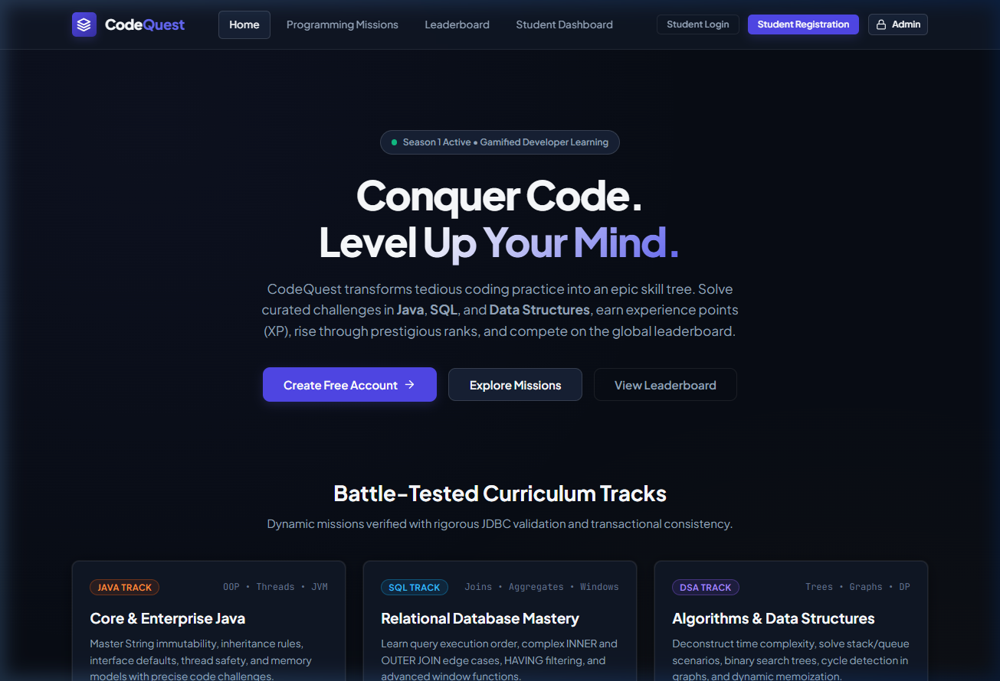
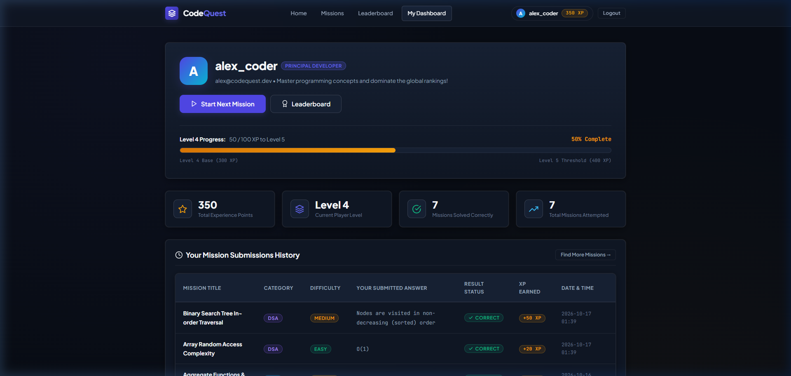
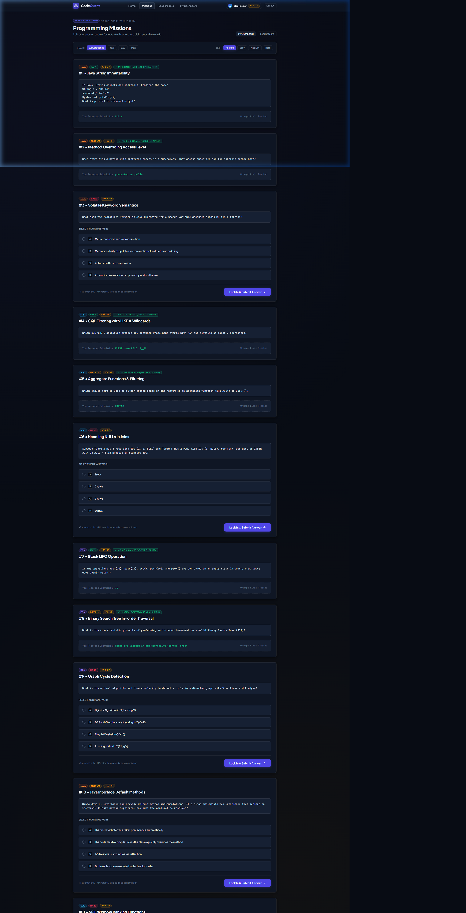
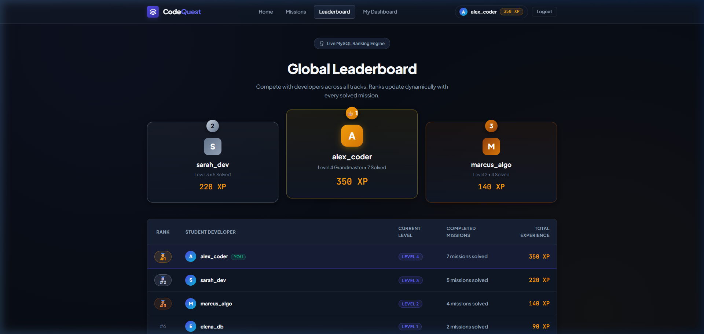
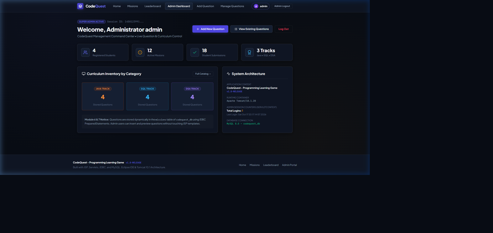
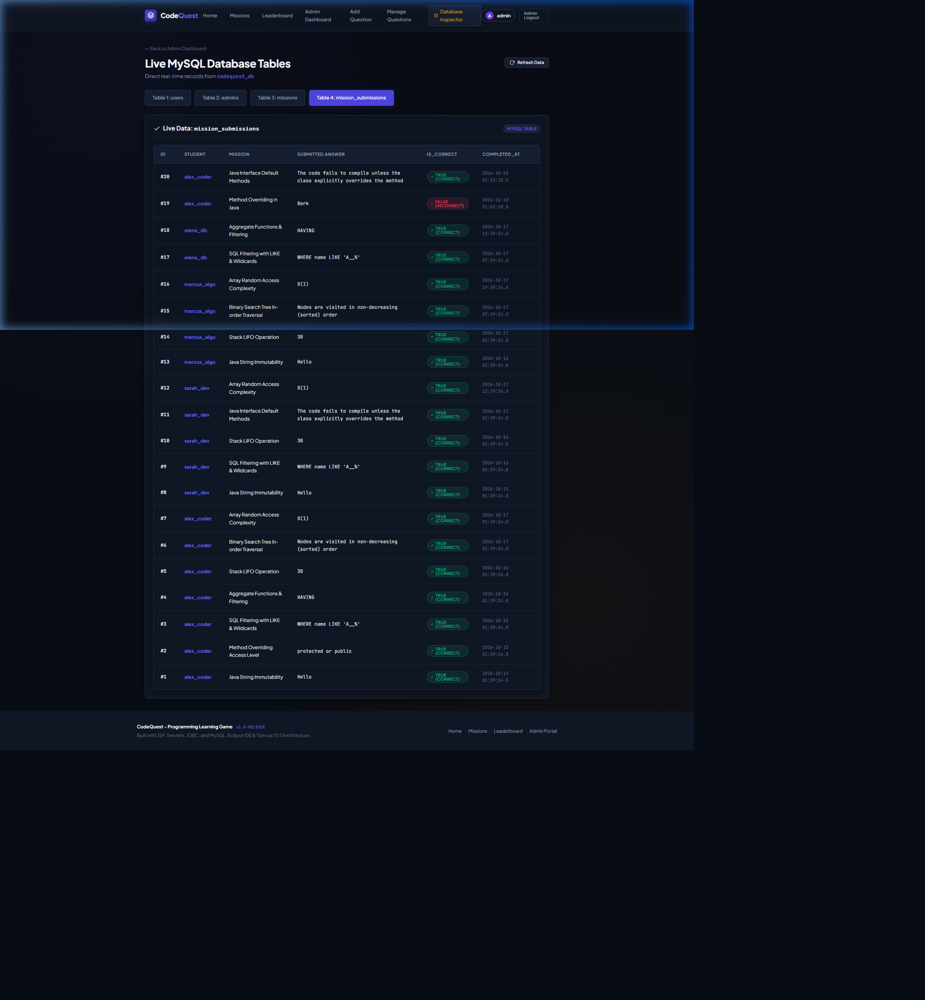

# ⚔️ CodeQuest – Programming Learning Game


> **Full-Stack Java Enterprise Web Application built with JSP, Servlets, JDBC, and MySQL for Apache Tomcat 10.1 and Eclipse IDE.**

CodeQuest is a gamified programming learning platform developed according to academic project specifications. Students can register, log in, solve curated coding missions across **Java**, **SQL**, and **Data Structures & Algorithms (DSA)**, earn experience points (XP), progress through levels, and compete on a live global leaderboard.

---

## 📸 Interface Screenshots

### 1. Home Landing Page (Module 1)
*Dark gaming-themed interface with minimalist obsidian aesthetics, curriculum tracks, and responsive navigation.*


---

### 2. Student Dashboard & Progress Tracking (Module 8)
*Personalized dashboard showing current Level, total XP, animated level progress bar, player rank title, and submission history.*


---

### 3. Programming Missions & Question Display (Module 9 & 10)
*Interactive programming questions filtered by Track (Java, SQL, DSA) and Tier (Easy, Medium, Hard). Demonstrates interactive option selection and strictly enforces the one-attempt-per-mission rule.*


---

### 4. Global Leaderboard with Top 3 Podium (Module 11)
*Dynamic leaderboard ranking students descending by XP with Gold, Silver, and Bronze metallic podium cards and current player highlighting.*


---

### 5. Admin Command Center & Metrics (Module 4)
*Dedicated administrative portal demonstrating `ServletConfig` init-parameters, `ServletContext` telemetry, and curriculum inventory.*


---

### 6. Live MySQL Database Inspector (Module 5 & 7)
*Real-time browser inspector for all 4 database tables (`users`, `admins`, `missions`, `mission_submissions`).*


---

## 🎨 UI/UX Design System (No Neon Colors)

* **Palette**: Tailored Obsidian (`#080c14`) and Deep Slate surfaces (`#0f1624`) with elegant jewel accents:
  * **Primary**: Sapphire Indigo (`#4f46e5`, `#6366f1`)
  * **XP & Mastery**: Imperial Amber Gold (`#d97706`, `#f59e0b`)
  * **Success**: Forest Jade (`#10b981`, `#059669`)
  * **Alerts**: Rose Wine (`#f43f5e`, `#e11d48`)
* **Enhanced Micro-Animations**:
  * Smooth card elevations with `cubic-bezier(0.16, 1, 0.3, 1)`.
  * Interactive answer choice cards (selecting anywhere on an option card activates smooth highlight).
  * Animated XP progress bar advancing toward next level threshold.
  * Lightweight canvas celebration confetti on winning mission submissions.
  * Top 3 metallic badges (🥇 Gold, 🥈 Silver, 🥉 Bronze).

---

## 📋 Module-by-Module Implementation

The application strictly complies with the specification: **no JSTL and no JSP Expression Language (`${...}`)**, using standard Java scriptlets (`<% ... %>`):

| Module | Requirement | Key Files | Description |
| :--- | :--- | :--- | :--- |
| **Module 1** | Home Page &amp; UI System | `index.html`<br>`css/style.css`<br>`js/app.js` | Dark gaming-themed landing page, responsive navbar linking to all 5 application sections. |
| **Module 2** | Student Registration | `register.jsp`<br>`RegisterServlet.java` | Validates username/email uniqueness, passwords match, initializes with 0 XP &amp; Level 1. |
| **Module 3** | Student Login &amp; Logout | `login.jsp`<br>`LoginServlet.java`<br>`LogoutServlet.java` | Username/email authentication, HTTP Session management, Remember-Me cookie demonstration, session invalidation. |
| **Module 4** | Admin Login &amp; Dashboard | `admin-login.jsp`<br>`AdminLoginServlet.java`<br>`admin-dashboard.jsp` | Separate admin session, security guards, demonstration of `ServletConfig` init-params and `ServletContext` telemetry. |
| **Module 5** | Database &amp; JDBC | `codequest_db.sql`<br>`DBConnection.java` | Relational design in `codequest_db`, 4 tables (`users`, `admins`, `missions`, `mission_submissions`), `PreparedStatement`. |
| **Module 6** | Admin Question Creation | `add-question.jsp`<br>`AddQuestionServlet.java` | Allows authenticated admins to dynamically add Java, SQL, and DSA questions with XP reward and 4 choices. |
| **Module 7** | Admin Question Management | `view-questions.jsp`<br>`ViewQuestionsServlet.java`<br>`DeleteQuestionServlet.java` | Displays all stored questions dynamically using JSP scriptlets, `RequestDispatcher.forward()`, delete capability. |
| **Module 8** | Student Dashboard | `dashboard.jsp`<br>`DashboardServlet.java` | Personalized student command center displaying total XP, current Level, mission completion count, and animated level progress bar. |
| **Module 9** | Programming Missions Display | `missions.jsp`<br>`MissionServlet.java` | Organizes questions by category &amp; difficulty. **Strict constraint met:** Correct answers are sanitized and never exposed to students. |
| **Module 10** | Evaluation &amp; XP Rewards | `SubmitAnswerServlet.java`<br>`mission-result.jsp` | One-attempt-per-mission enforcement, atomic JDBC transactions (`setAutoCommit(false)`, `commit()`), automatic XP and Level calculations. |
| **Module 11** | Global Leaderboard | `leaderboard.jsp`<br>`LeaderboardServlet.java` | Ranks all students descending by XP, Top 3 Gold/Silver/Bronze podium indicators, live updates. |
| **Module 12** | Integration &amp; Configuration | `web.xml`<br>`AppLifecycleListener.java` | End-to-end routing, role guards, cookies, session invalidation, error alerts on existing pages without standalone error pages. |

---

## 🗄️ Database Architecture (`codequest_db`)

The database script is located at [`database/codequest_db.sql`](database/codequest_db.sql):

### 1. `users`
Stores student accounts and progress:
* `id` INT, PK, AUTO_INCREMENT
* `username` VARCHAR(50), UNIQUE
* `email` VARCHAR(100), UNIQUE
* `password` VARCHAR(255)
* `total_xp` INT DEFAULT 0
* `player_level` INT DEFAULT 1
* `created_at` TIMESTAMP

### 2. `admins`
Stores administrator credentials:
* `id` INT, PK, AUTO_INCREMENT
* `username` VARCHAR(50), UNIQUE
* `password` VARCHAR(255)

### 3. `missions`
Stores questions created by administrators:
* `id` INT, PK, AUTO_INCREMENT
* `title` VARCHAR(100)
* `description` TEXT
* `category` VARCHAR(30) (Java, SQL, DSA)
* `difficulty` VARCHAR(20) (Easy, Medium, Hard)
* `option_a`, `option_b`, `option_c`, `option_d` VARCHAR(255)
* `correct_answer` VARCHAR(255)
* `xp_reward` INT DEFAULT 50
* `created_by` INT, FK references `admins(id)`

### 4. `mission_submissions`
Tracks student answers and completion:
* `id` INT, PK, AUTO_INCREMENT
* `user_id` INT, FK references `users(id)`
* `mission_id` INT, FK references `missions(id)`
* `answer` VARCHAR(255)
* `is_correct` BOOLEAN DEFAULT FALSE
* `completed_at` TIMESTAMP
* `UNIQUE KEY unique_user_mission (user_id, mission_id)` *(Database constraint enforcing the one-attempt-per-mission rule)*

---

## 🔑 Default Test Credentials

| Role | Username | Password | Purpose |
| :--- | :--- | :--- | :--- |
| **Administrator** | `admin` | `admin123` | Access `/admin-dashboard`, add/manage questions |
| **Student (Demo #1)** | `alex_coder` | `password123` | Level 5, 410 XP (8 missions solved) |
| **Student (Demo #2)** | `sarah_dev` | `password123` | Level 3, 220 XP (5 missions solved) |
| **Student (Demo #3)** | `marcus_algo` | `password123` | Level 2, 140 XP (4 missions solved) |
| **New Student** | *Register in UI* | *Your choice* | Starts at Level 1, 0 XP |

---

## 🚀 Setup & Execution Guide

### 1. Initialize MySQL Database
Run the provided SQL script in MySQL Workbench or Command Line:
```sql
source database/codequest_db.sql;
```

### 2. Import into Eclipse IDE
1. Open **Eclipse IDE for Enterprise Java and Web Developers** (JDK 17).
2. Go to **File &rarr; Open Projects from File System...** &rarr; select this repository folder.
3. Eclipse automatically loads `.project`, `.classpath`, and `.settings/`.

### 3. Run on Apache Tomcat 10.1
1. Right-click the project &rarr; **Run As &rarr; Run on Server**.
2. Select **Apache Tomcat v10.1** and click **Finish**.
3. Access in your browser:
   ```
   http://localhost:8080/codequest/
   ```
